# My Pod app screenshot library

**[Open the screenshot gallery](https://sundar2005.github.io/my-pod-app-preview/)** · **[Download all screenshots](my-pod-screenshots.zip)**

45 actual native Android captures, organised into 8 groups. App preview version **0.3.0**, captured 31 October 2026. All people and activity shown are sample data. This is not a live monitoring service.

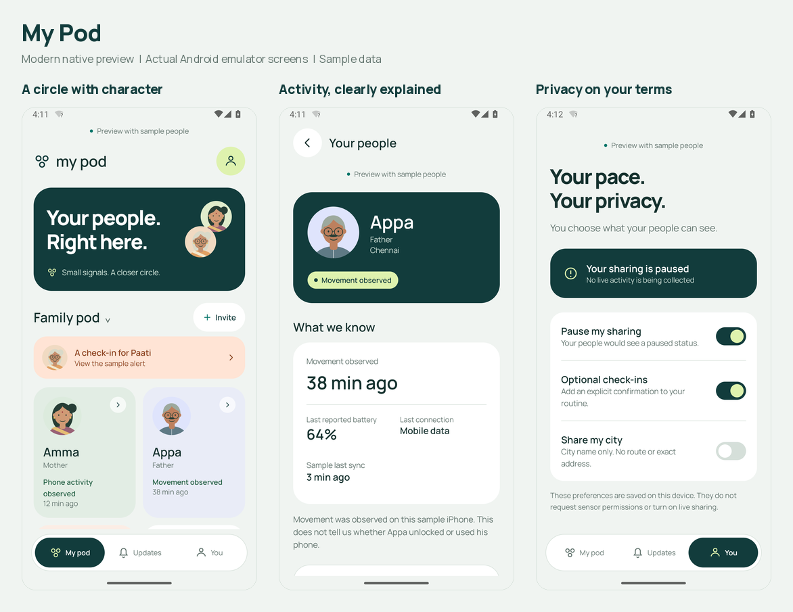

The gallery supports category filters, search, full-resolution viewing, keyboard navigation and direct links to individual screens. The original PNG files are in [screenshots](screenshots/); smaller WebP images are used only for fast gallery loading.

[See the three-pod use-case guide](USE-CASES.md) for Family, Close Buddies, Office and the current development boundaries.

## Screenshot index

<strong>Getting started</strong> — 2 screens

### 01 Welcome and product introduction

<a href="screenshots/01-welcome.png">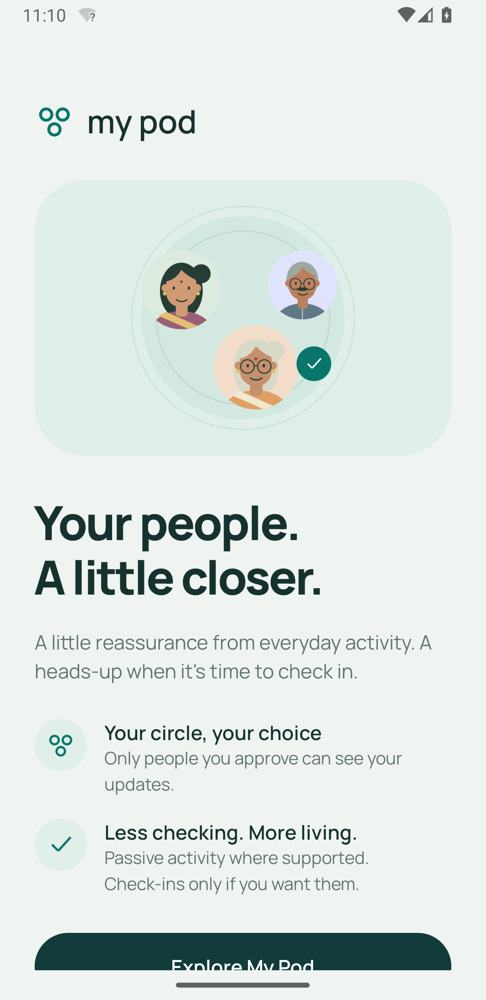</a>

The first-run introduction explains the small trusted circle and optional check-ins.

**Flow:** Open My Pod for the first time

[Full-resolution image](screenshots/01-welcome.png) · [Direct gallery link](https://sundar2005.github.io/my-pod-app-preview/#screen=welcome)

### 02 What sharing means

<a href="screenshots/02-welcome-consent.png">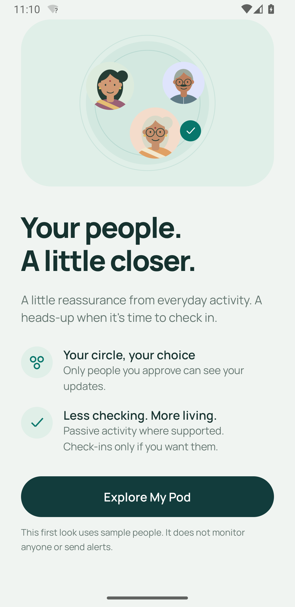</a>

The lower welcome screen explains approved people and clearly identifies the sample experience.

**Flow:** Open the welcome screen → Scroll to the introduction and primary action

[Full-resolution image](screenshots/02-welcome-consent.png) · [Direct gallery link](https://sundar2005.github.io/my-pod-app-preview/#screen=welcome-consent)

<strong>Pods and people</strong> — 5 screens

### 03 Family pod overview

<a href="screenshots/03-family-overview.png">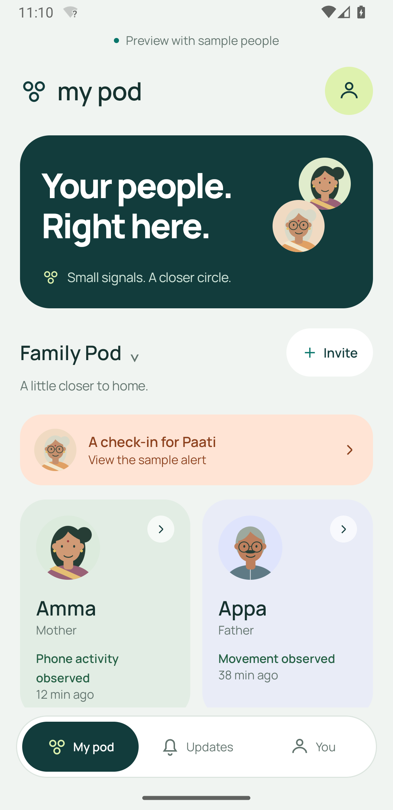</a>

The main dashboard shows the family, an outstanding sample alert, and recent evidence.

**Flow:** Explore My Pod

[Full-resolution image](screenshots/03-family-overview.png) · [Direct gallery link](https://sundar2005.github.io/my-pod-app-preview/#screen=family-overview)

### 04 All four sample people

<a href="screenshots/04-family-people.png">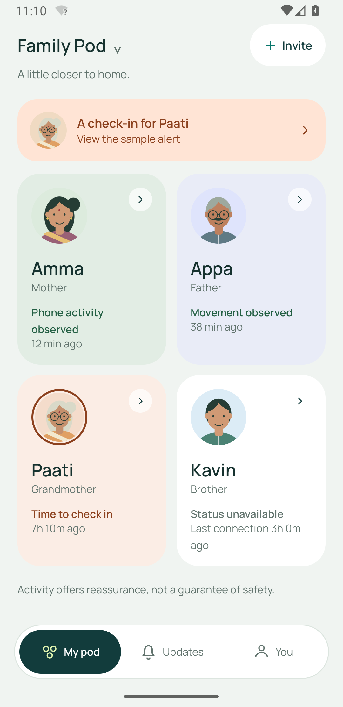</a>

Scroll continuation includes Paati with an activity gap and Kavin with unavailable human-activity status.

**Flow:** Open Family pod → Scroll through the people tiles

[Full-resolution image](screenshots/04-family-people.png) · [Direct gallery link](https://sundar2005.github.io/my-pod-app-preview/#screen=family-people)

### 05 Choose a pod

<a href="screenshots/05-pod-selector.png">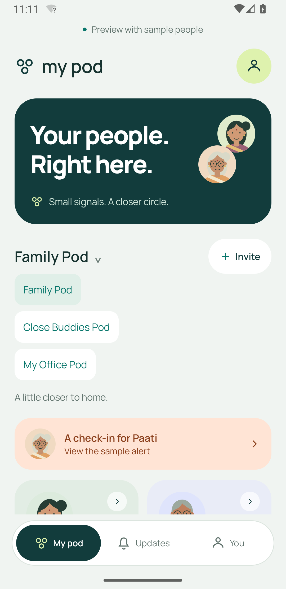</a>

Family Pod, Close Buddies Pod and My Office Pod are separate populated circles in the local preview.

**Flow:** Open My pod → Open the Family pod selector

[Full-resolution image](screenshots/05-pod-selector.png) · [Direct gallery link](https://sundar2005.github.io/my-pod-app-preview/#screen=pod-selector)

### 06 Close Buddies Pod overview

<a href="screenshots/06-buddies-overview.png">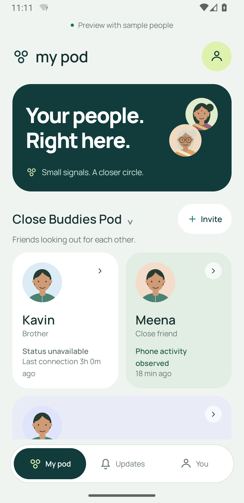</a>

A populated friends circle shows Meena, Arjun and Kavin; Kavin also belongs to Family.

**Flow:** Choose Close Buddies Pod

[Full-resolution image](screenshots/06-buddies-overview.png) · [Direct gallery link](https://sundar2005.github.io/my-pod-app-preview/#screen=buddies-overview)

### 07 My Office Pod overview

<a href="screenshots/07-office-overview.png">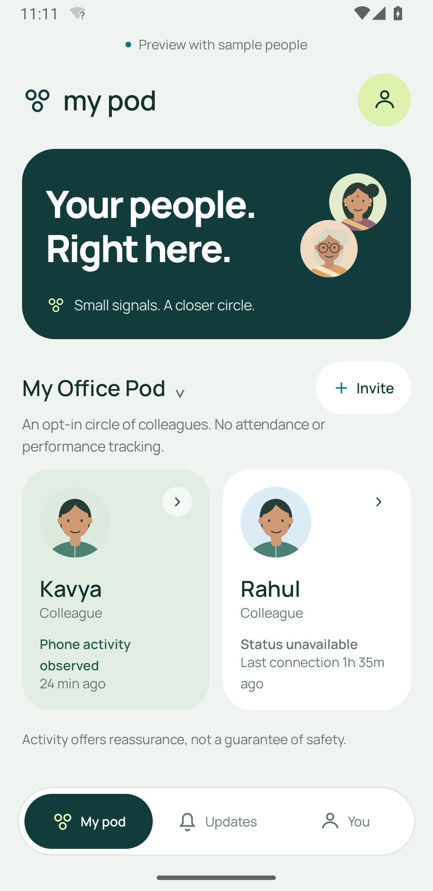</a>

Kavya and Rahul form a separate opt-in colleagues circle, without attendance or performance tracking.

**Flow:** Choose My Office Pod

[Full-resolution image](screenshots/07-office-overview.png) · [Direct gallery link](https://sundar2005.github.io/my-pod-app-preview/#screen=office-overview)

<strong>Activity and evidence</strong> — 5 screens

### 08 Amma — phone activity

<a href="screenshots/08-person-phone-activity.png">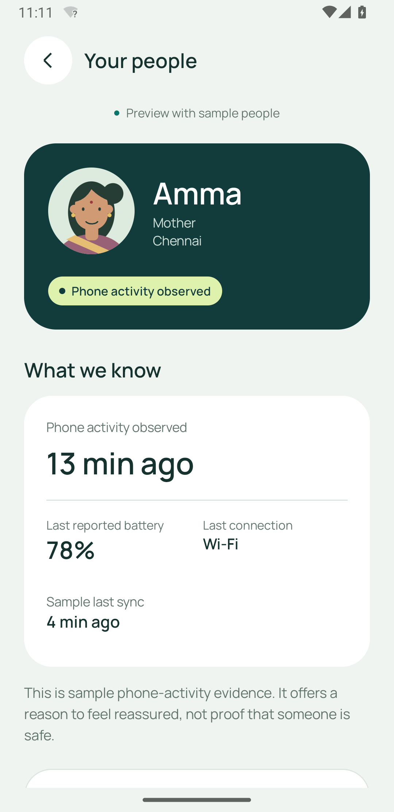</a>

Recent sample phone interaction, with its original observation age.

**Flow:** Open Family pod → Open Amma

[Full-resolution image](screenshots/08-person-phone-activity.png) · [Direct gallery link](https://sundar2005.github.io/my-pod-app-preview/#screen=person-phone-activity)

### 09 Appa — movement

<a href="screenshots/09-person-movement.png">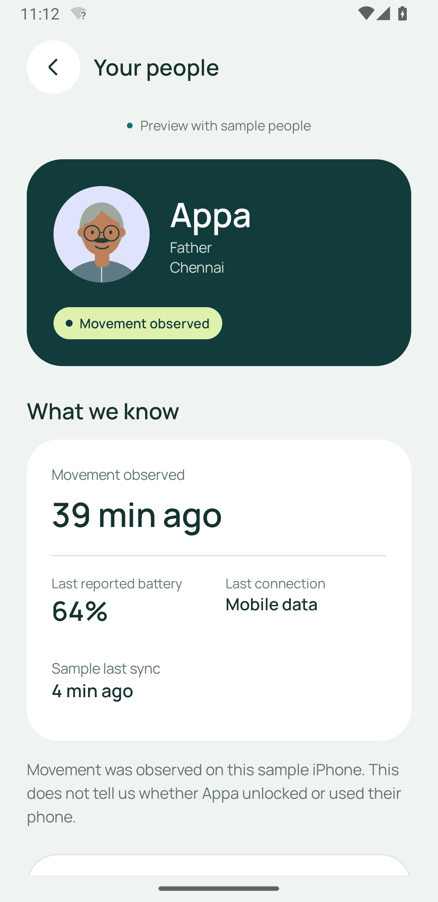</a>

Movement-based reassurance is labelled as movement, not an unlock. This is an Android rendering of sample iPhone evidence, not an iOS screenshot.

**Flow:** Open Family pod → Open Appa

[Full-resolution image](screenshots/09-person-movement.png) · [Direct gallery link](https://sundar2005.github.io/my-pod-app-preview/#screen=person-movement)

### 10 Contact actions and evidence explanation

<a href="screenshots/10-person-actions.png">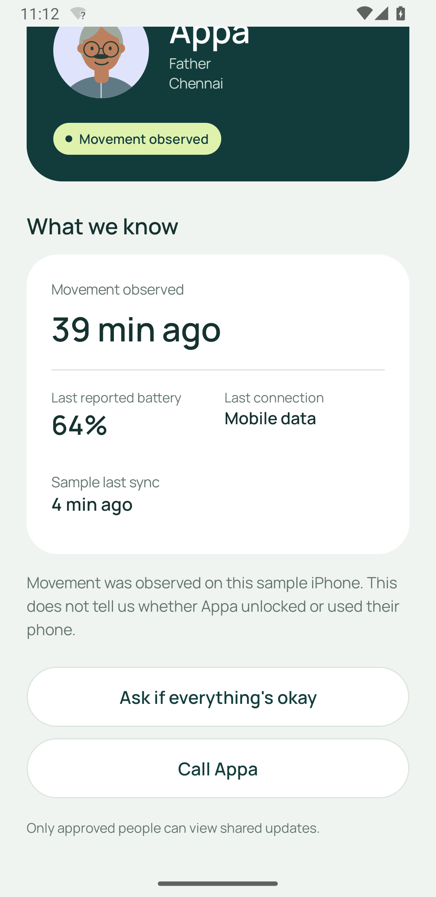</a>

Scroll continuation explains the limits of movement evidence and exposes check-in/call actions.

**Flow:** Open Appa → Scroll to the explanation and contact actions

[Full-resolution image](screenshots/10-person-actions.png) · [Direct gallery link](https://sundar2005.github.io/my-pod-app-preview/#screen=person-actions)

### 13 Paati — activity gap

<a href="screenshots/13-person-activity-gap.png">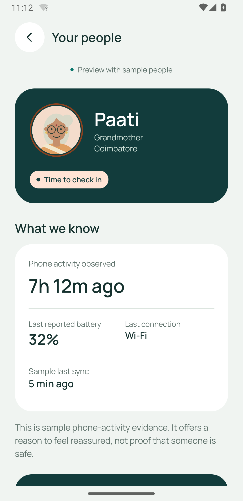</a>

An activity gap prompts a check-in; it does not claim that an emergency has occurred.

**Flow:** Open Family pod → Open Paati

[Full-resolution image](screenshots/13-person-activity-gap.png) · [Direct gallery link](https://sundar2005.github.io/my-pod-app-preview/#screen=person-activity-gap)

### 14 Kavin — unavailable

<a href="screenshots/14-person-unavailable.png">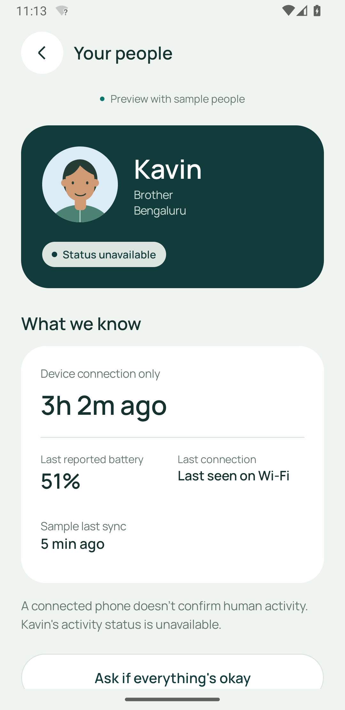</a>

Device connectivity alone does not establish human activity. The status remains unavailable.

**Flow:** Open Family pod → Open Kavin

[Full-resolution image](screenshots/14-person-unavailable.png) · [Direct gallery link](https://sundar2005.github.io/my-pod-app-preview/#screen=person-unavailable)

<strong>Invitations and contact</strong> — 5 screens

### 11 Quick check-in message preview

<a href="screenshots/11-check-in-message-preview.png">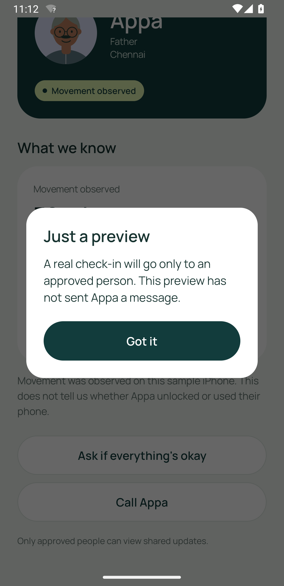</a>

The dialog states that this sample action has not sent a message.

**Flow:** Open Appa → Choose Ask if everything is okay

[Full-resolution image](screenshots/11-check-in-message-preview.png) · [Direct gallery link](https://sundar2005.github.io/my-pod-app-preview/#screen=check-in-message-preview)

### 12 Call action preview

<a href="screenshots/12-call-preview.png">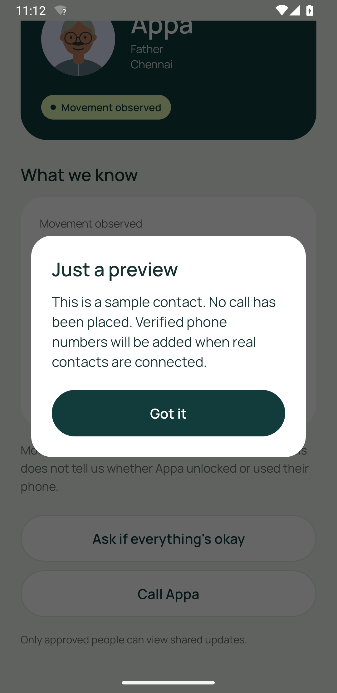</a>

The sample contact has no real number. No phone call is placed.

**Flow:** Open Appa → Choose Call Appa

[Full-resolution image](screenshots/12-call-preview.png) · [Direct gallery link](https://sundar2005.github.io/my-pod-app-preview/#screen=call-preview)

### 15 Invite someone into your pod

<a href="screenshots/15-invite-form.png">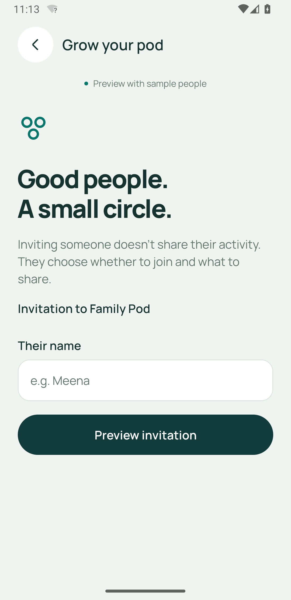</a>

An invitation does not grant access: the recipient chooses whether to join and share.

**Flow:** Open My pod → Choose Invite

[Full-resolution image](screenshots/15-invite-form.png) · [Direct gallery link](https://sundar2005.github.io/my-pod-app-preview/#screen=invite-form)

### 16 Invitation validation

<a href="screenshots/16-invite-validation.png">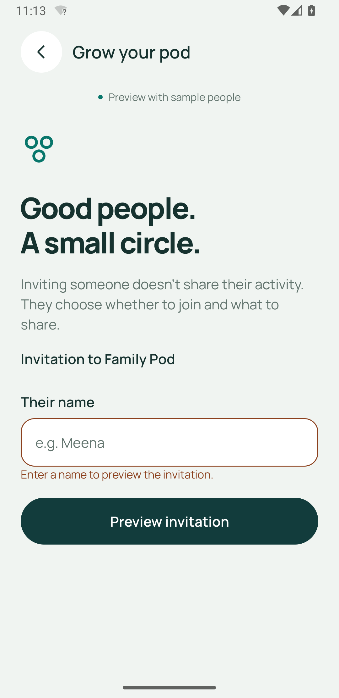</a>

A missing name produces an inline validation message.

**Flow:** Open Invite → Preview without a name

[Full-resolution image](screenshots/16-invite-validation.png) · [Direct gallery link](https://sundar2005.github.io/my-pod-app-preview/#screen=invite-validation)

### 17 Personalised invitation preview

<a href="screenshots/17-invite-preview.png">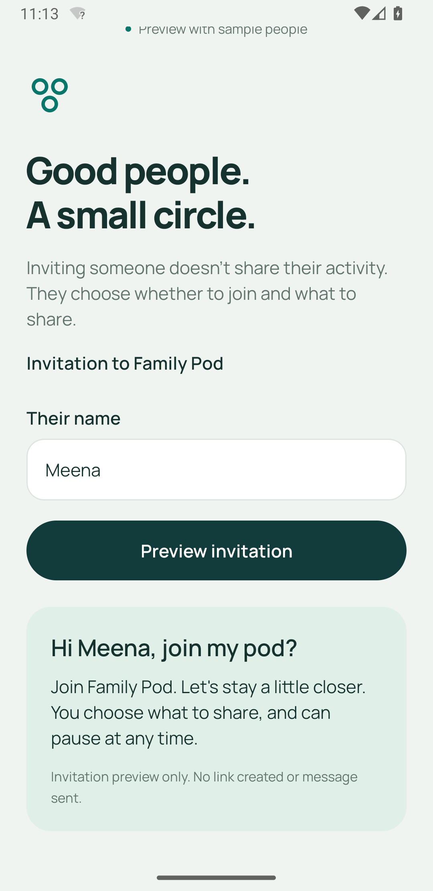</a>

A sample invitation is prepared locally. No invitation link or message is sent.

**Flow:** Enter the sample name Meena → Choose Preview invitation → Scroll to the invitation

[Full-resolution image](screenshots/17-invite-preview.png) · [Direct gallery link](https://sundar2005.github.io/my-pod-app-preview/#screen=invite-preview)

<strong>Alerts and follow-up</strong> — 6 screens

### 18 Updates with an open check-in

<a href="screenshots/18-updates-open.png">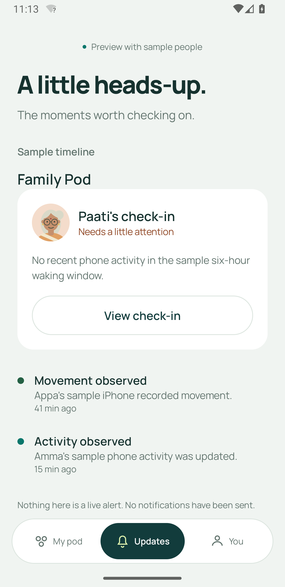</a>

The activity timeline distinguishes an unresolved check-in from routine evidence.

**Flow:** Open Updates

[Full-resolution image](screenshots/18-updates-open.png) · [Direct gallery link](https://sundar2005.github.io/my-pod-app-preview/#screen=updates-open)

### 19 Check-in needs attention

<a href="screenshots/19-incident-open.png">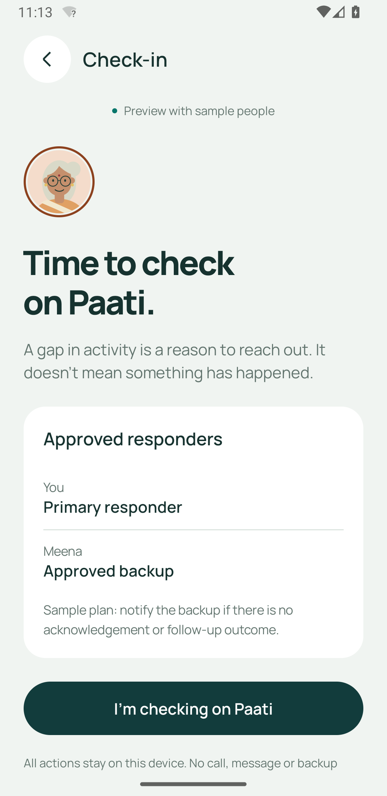</a>

Only approved sample responders appear. An activity gap is described conservatively.

**Flow:** Open Updates → View check-in

[Full-resolution image](screenshots/19-incident-open.png) · [Direct gallery link](https://sundar2005.github.io/my-pod-app-preview/#screen=incident-open)

### 20 Approved responder plan

<a href="screenshots/20-approved-responders.png">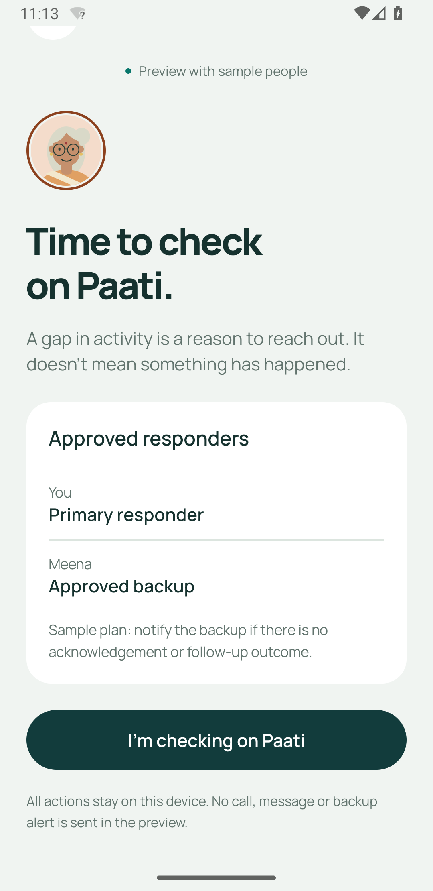</a>

Scroll continuation shows the primary responder, approved backup and local-demo boundary.

**Flow:** Open the sample check-in → Scroll through the responder plan

[Full-resolution image](screenshots/20-approved-responders.png) · [Direct gallery link](https://sundar2005.github.io/my-pod-app-preview/#screen=approved-responders)

### 21 Responder acknowledges follow-up

<a href="screenshots/21-incident-acknowledged.png">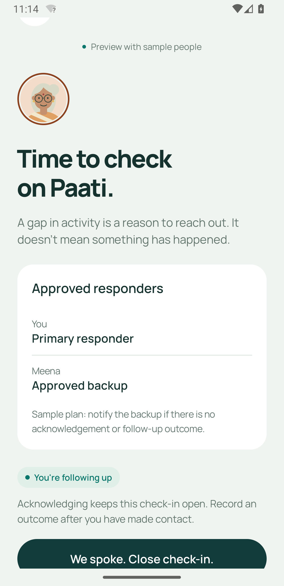</a>

Acknowledgement records ownership but keeps the check-in open until an outcome is recorded.

**Flow:** Choose I am checking on Paati

[Full-resolution image](screenshots/21-incident-acknowledged.png) · [Direct gallery link](https://sundar2005.github.io/my-pod-app-preview/#screen=incident-acknowledged)

### 22 Contact outcome recorded

<a href="screenshots/22-incident-closed.png">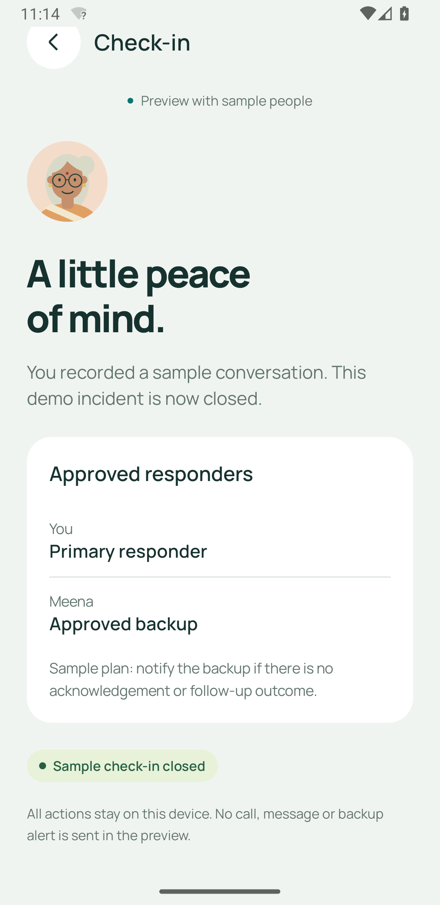</a>

The person following up records a sample conversation and closes this local incident.

**Flow:** Record We spoke. Close check-in.

[Full-resolution image](screenshots/22-incident-closed.png) · [Direct gallery link](https://sundar2005.github.io/my-pod-app-preview/#screen=incident-closed)

### 23 Updates after resolution

<a href="screenshots/23-updates-closed.png">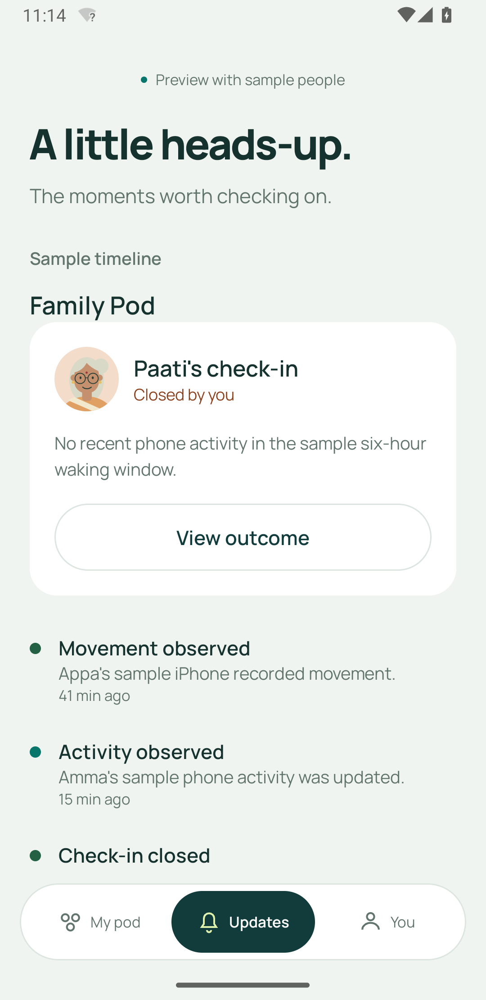</a>

The timeline now reflects the recorded outcome rather than an unresolved alert.

**Flow:** Close the incident → Return to Updates

[Full-resolution image](screenshots/23-updates-closed.png) · [Direct gallery link](https://sundar2005.github.io/my-pod-app-preview/#screen=updates-closed)

<strong>Privacy and control</strong> — 7 screens

### 24 Privacy preferences by default

<a href="screenshots/24-privacy-default.png">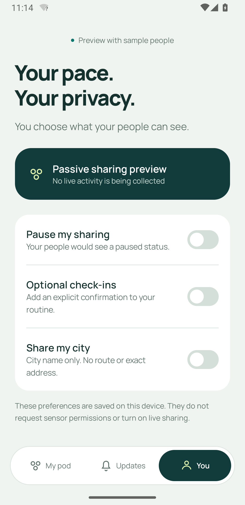</a>

Passive sharing is a preview. Optional explicit check-ins and city sharing start off.

**Flow:** Open You

[Full-resolution image](screenshots/24-privacy-default.png) · [Direct gallery link](https://sundar2005.github.io/my-pod-app-preview/#screen=privacy-default)

### 25 Sharing paused

<a href="screenshots/25-sharing-paused.png">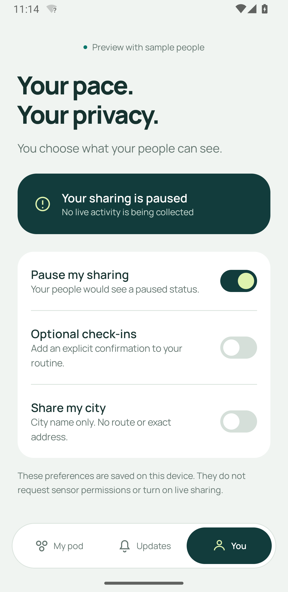</a>

A deliberate pause is visible; it is not confused with an activity gap.

**Flow:** Turn on Pause my sharing

[Full-resolution image](screenshots/25-sharing-paused.png) · [Direct gallery link](https://sundar2005.github.io/my-pod-app-preview/#screen=sharing-paused)

### 26 Explicit check-ins enabled optionally

<a href="screenshots/26-optional-check-ins.png">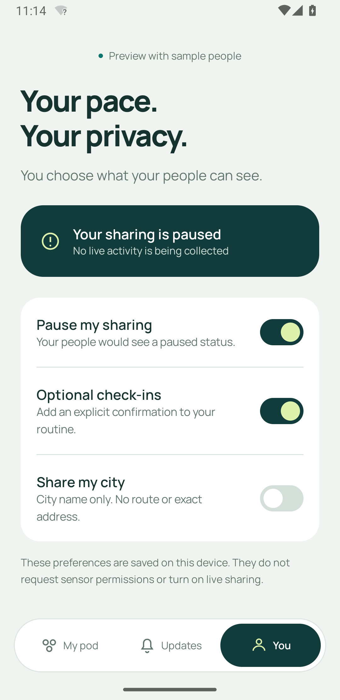</a>

An explicit confirmation can be added without becoming compulsory for every user.

**Flow:** Enable Optional check-ins

[Full-resolution image](screenshots/26-optional-check-ins.png) · [Direct gallery link](https://sundar2005.github.io/my-pod-app-preview/#screen=optional-check-ins)

### 27 City sharing preference

<a href="screenshots/27-city-sharing.png">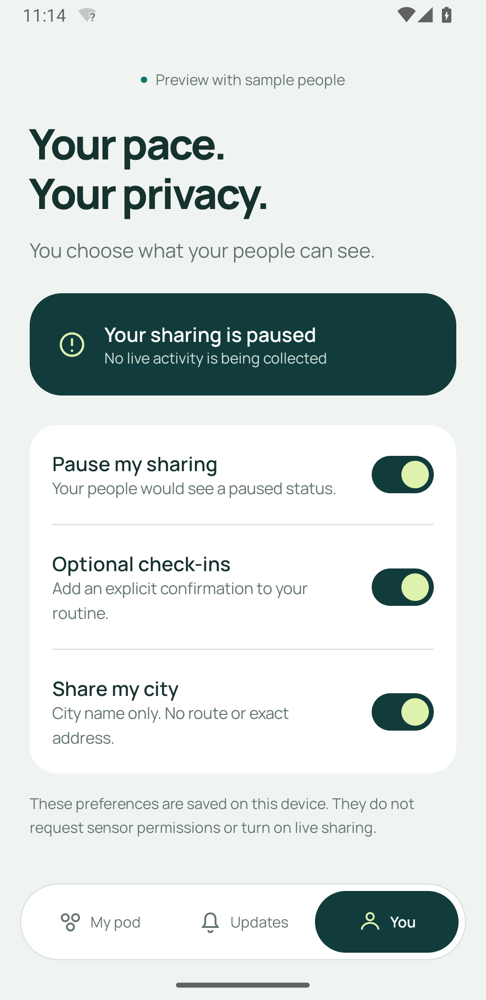</a>

The local preference is city-level sharing, not a route or exact address. No location permission is requested in this build.

**Flow:** Enable Share my city

[Full-resolution image](screenshots/27-city-sharing.png) · [Direct gallery link](https://sundar2005.github.io/my-pod-app-preview/#screen=city-sharing)

### 28 Approved people and privacy actions

<a href="screenshots/28-approved-people.png">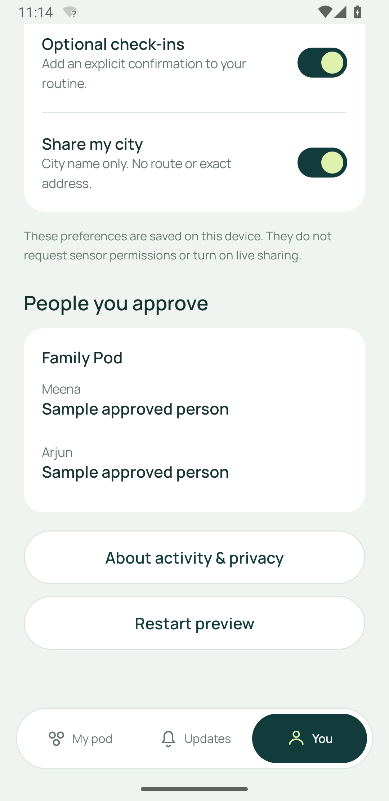</a>

Scroll continuation lists sample approved people and exposes privacy information and reset.

**Flow:** Open You → Scroll to People you approve

[Full-resolution image](screenshots/28-approved-people.png) · [Direct gallery link](https://sundar2005.github.io/my-pod-app-preview/#screen=approved-people)

### 29 Activity and privacy explanation

<a href="screenshots/29-privacy-explanation.png">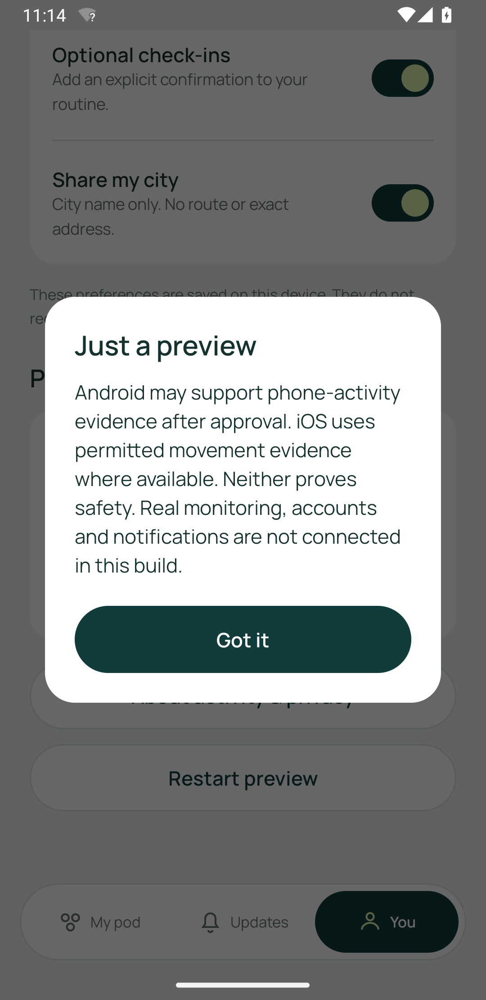</a>

The dialog explains platform limits and that sensors, accounts and remote notifications are not connected.

**Flow:** Choose About activity & privacy

[Full-resolution image](screenshots/29-privacy-explanation.png) · [Direct gallery link](https://sundar2005.github.io/my-pod-app-preview/#screen=privacy-explanation)

### 30 Restart preview confirmation

<a href="screenshots/30-reset-confirmation.png">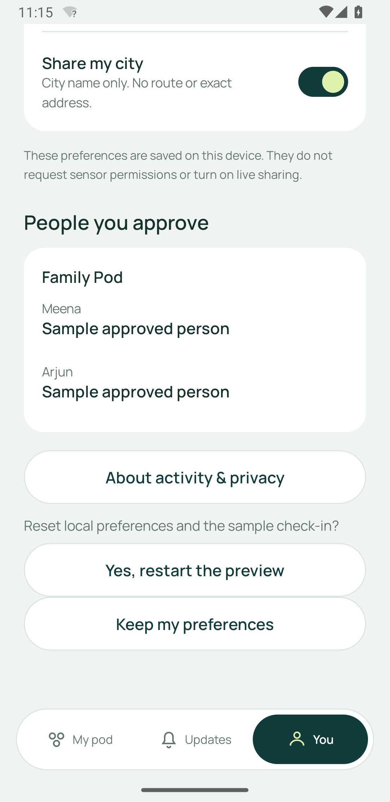</a>

Reset requires an explicit choice, with an option to keep preferences.

**Flow:** Choose Restart preview

[Full-resolution image](screenshots/30-reset-confirmation.png) · [Direct gallery link](https://sundar2005.github.io/my-pod-app-preview/#screen=reset-confirmation)

<strong>Accessibility</strong> — 4 screens

### 31 Larger text and single-column people

<a href="screenshots/31-large-text-home.png">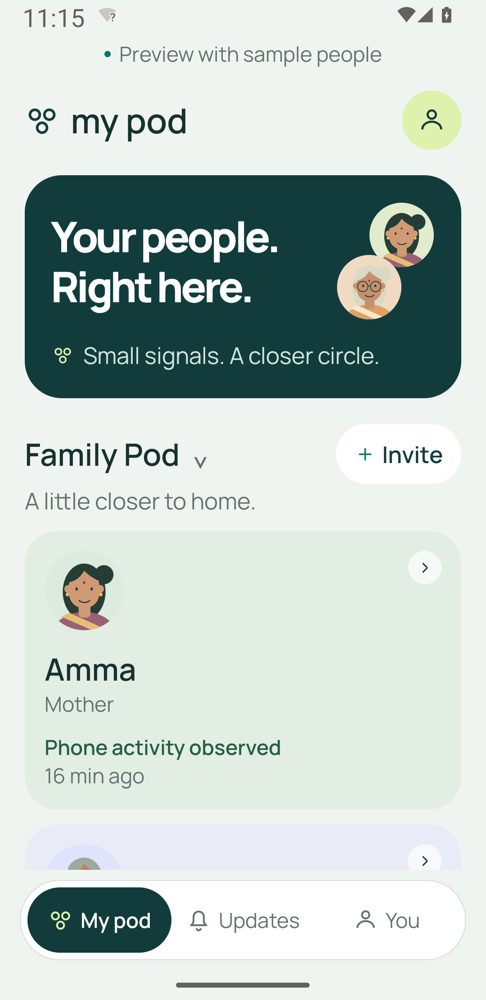</a>

At 1.4-times text size, the people layout switches to a roomier single column.

**Flow:** Set Android text scale to 1.4 → Open My pod

[Full-resolution image](screenshots/31-large-text-home.png) · [Direct gallery link](https://sundar2005.github.io/my-pod-app-preview/#screen=large-text-home)

### 32 Single-column people tiles

<a href="screenshots/32-large-text-people.png">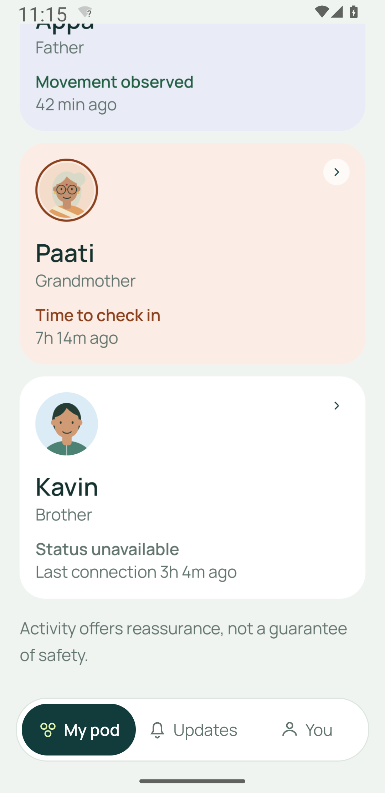</a>

Scroll continuation shows the larger-text people layout without squeezing two cards together.

**Flow:** Use 1.4-times text → Scroll through Family pod

[Full-resolution image](screenshots/32-large-text-people.png) · [Direct gallery link](https://sundar2005.github.io/my-pod-app-preview/#screen=large-text-people)

### 33 Larger-text evidence details

<a href="screenshots/33-large-text-details.png">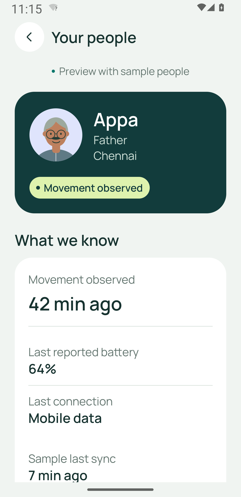</a>

Identity, evidence and device metrics remain scrollable; the metrics stack vertically.

**Flow:** Use 1.4-times text → Open Appa

[Full-resolution image](screenshots/33-large-text-details.png) · [Direct gallery link](https://sundar2005.github.io/my-pod-app-preview/#screen=large-text-details)

### 34 Larger-text privacy controls

<a href="screenshots/34-large-text-privacy.png">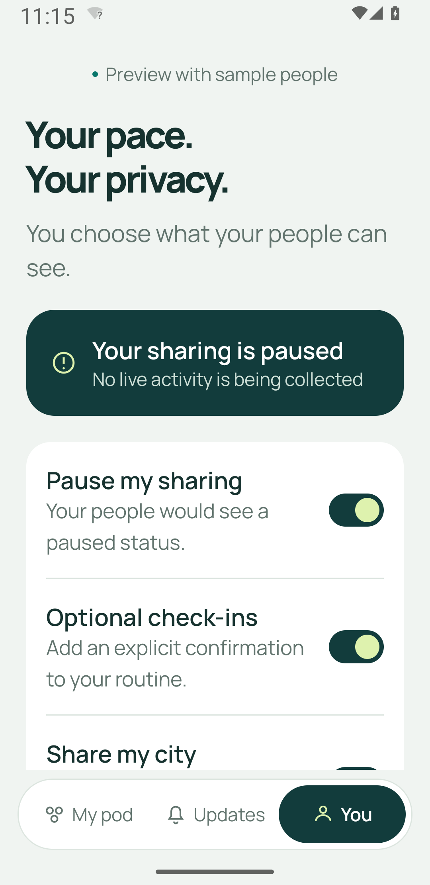</a>

The preference controls remain reachable with larger text.

**Flow:** Use 1.4-times text → Open You

[Full-resolution image](screenshots/34-large-text-privacy.png) · [Direct gallery link](https://sundar2005.github.io/my-pod-app-preview/#screen=large-text-privacy)

<strong>Multiple pods</strong> — 11 screens

### 35 Friends and overlapping membership

<a href="screenshots/35-buddies-members.png">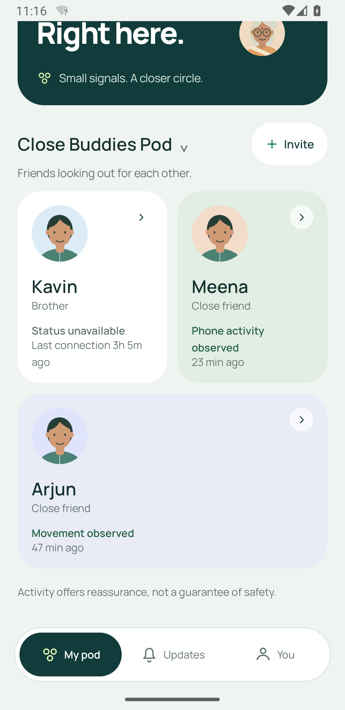</a>

Meena and Arjun are close friends; Kavin appears in both Family and Close Buddies. Family-only people do not appear here.

**Flow:** Choose Close Buddies Pod → Scroll to all members

[Full-resolution image](screenshots/35-buddies-members.png) · [Direct gallery link](https://sundar2005.github.io/my-pod-app-preview/#screen=buddies-members)

### 36 Close friend activity details

<a href="screenshots/36-buddies-person.png">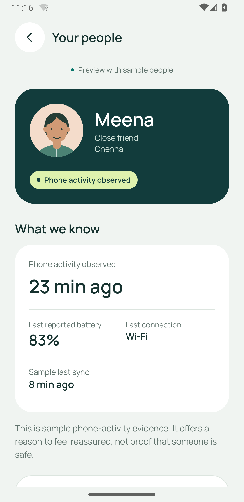</a>

A friend has their own sample evidence and contact actions.

**Flow:** Choose Close Buddies Pod → Open Meena

[Full-resolution image](screenshots/36-buddies-person.png) · [Direct gallery link](https://sundar2005.github.io/my-pod-app-preview/#screen=buddies-person)

### 37 Invitation targets Close Buddies

<a href="screenshots/37-buddies-invitation.png">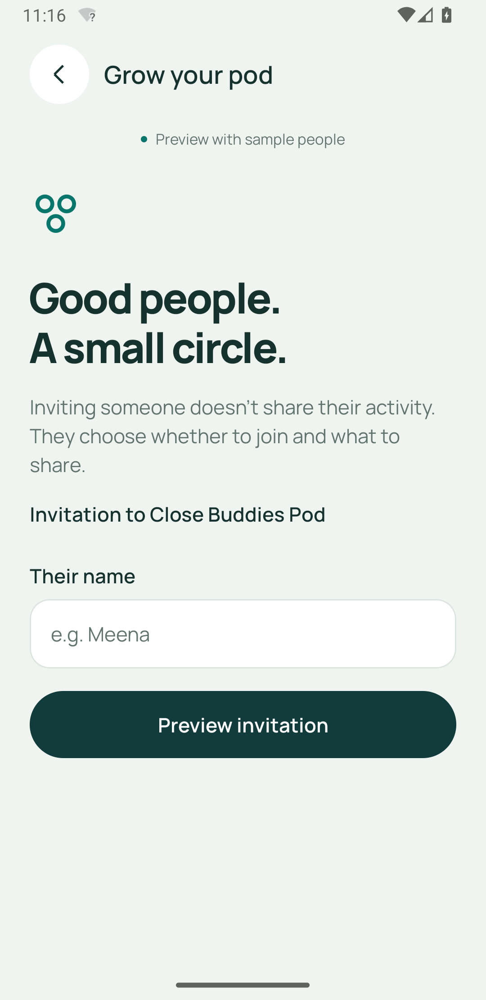</a>

The destination pod is visible before creating an invitation preview. Joining and sharing require consent.

**Flow:** Choose Close Buddies Pod → Choose Invite

[Full-resolution image](screenshots/37-buddies-invitation.png) · [Direct gallery link](https://sundar2005.github.io/my-pod-app-preview/#screen=buddies-invitation)

### 38 Close Buddies updates stay separate

<a href="screenshots/38-buddies-updates.png">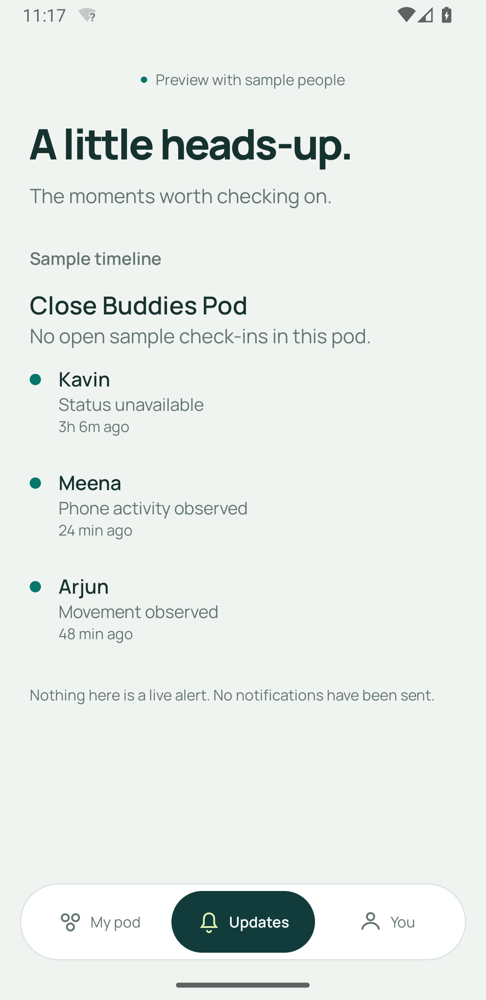</a>

Friends updates have no Family incident. Switching tabs retains the selected circle.

**Flow:** Choose Close Buddies Pod → Open Updates

[Full-resolution image](screenshots/38-buddies-updates.png) · [Direct gallery link](https://sundar2005.github.io/my-pod-app-preview/#screen=buddies-updates)

### 39 Office colleagues and consent boundary

Kavya and Rahul are office-only members. This is a voluntary wellbeing circle, not an attendance system.

**Flow:** Choose My Office Pod

[Full-resolution image](screenshots/39-office-members.png) · [Direct gallery link](https://sundar2005.github.io/my-pod-app-preview/#screen=office-members)

### 40 Office colleague with unavailable status

<a href="screenshots/40-office-unavailable.png">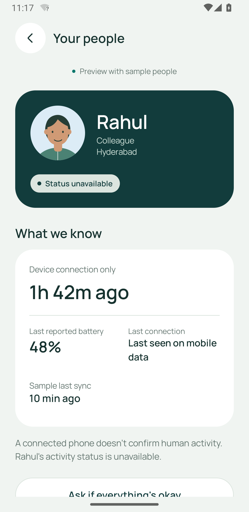</a>

A device connection is not evidence that Rahul is active. The same conservative evidence rules apply in every pod.

**Flow:** Choose My Office Pod → Open Rahul

[Full-resolution image](screenshots/40-office-unavailable.png) · [Direct gallery link](https://sundar2005.github.io/my-pod-app-preview/#screen=office-unavailable)

### 41 Invitation targets My Office Pod

<a href="screenshots/41-office-invitation.png">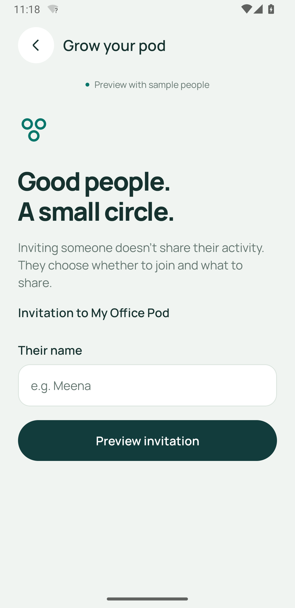</a>

An office invitation names its destination. It does not automatically enrol colleagues or grant access.

**Flow:** Choose My Office Pod → Choose Invite

[Full-resolution image](screenshots/41-office-invitation.png) · [Direct gallery link](https://sundar2005.github.io/my-pod-app-preview/#screen=office-invitation)

### 42 Office-only updates

<a href="screenshots/42-office-updates.png">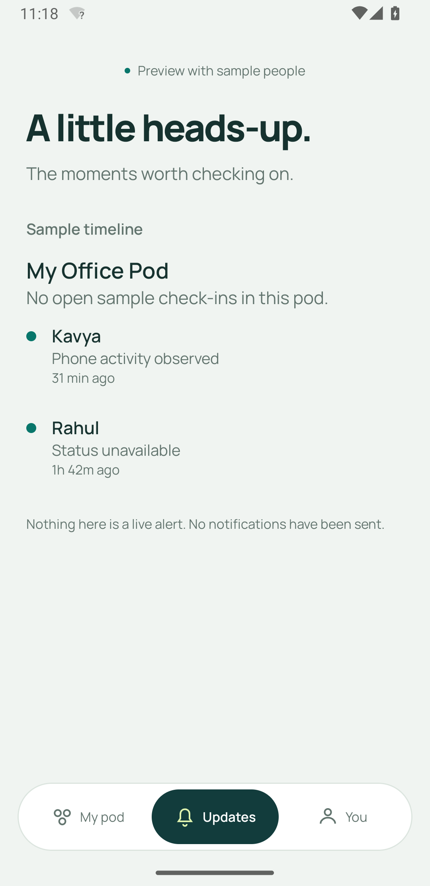</a>

Only colleague evidence is listed. Family incident actions are absent.

**Flow:** Choose My Office Pod → Open Updates

[Full-resolution image](screenshots/42-office-updates.png) · [Direct gallery link](https://sundar2005.github.io/my-pod-app-preview/#screen=office-updates)

### 43 Office approved-people preview

<a href="screenshots/43-office-approved-people.png">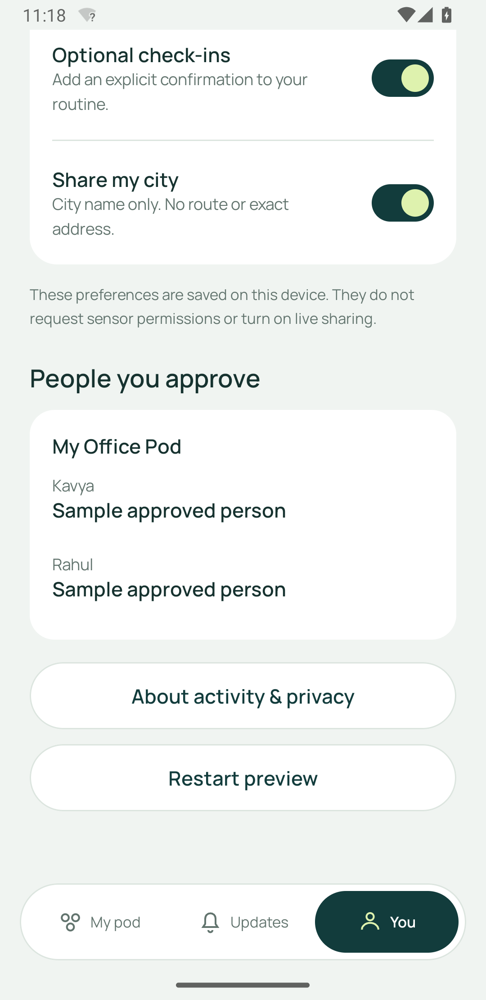</a>

The sample approved-people list follows the selected pod. Global sharing preferences remain device-wide in this preview.

**Flow:** Choose My Office Pod → Open You → Scroll to People you approve

[Full-resolution image](screenshots/43-office-approved-people.png) · [Direct gallery link](https://sundar2005.github.io/my-pod-app-preview/#screen=office-approved-people)

### 44 Pod selection survives app restart

The local preview remembers My Office Pod after a force-stop and relaunch.

**Flow:** Choose My Office Pod → Close and reopen the app

[Full-resolution image](screenshots/44-pod-restored.png) · [Direct gallery link](https://sundar2005.github.io/my-pod-app-preview/#screen=pod-restored)

### 45 Family follow-up survives pod switching

Returning to Family restores its recorded outcome. Visiting another pod does not reset the Family incident.

**Flow:** Close the Family sample check-in → Visit Buddies and Office → Return to Family Pod and Updates

[Full-resolution image](screenshots/45-family-return.png) · [Direct gallery link](https://sundar2005.github.io/my-pod-app-preview/#screen=family-return)

## Coverage and limits

- These are Android app screenshots. The Appa screen demonstrates sample movement-based status; it is not a native iOS screenshot. Native iOS captures await Mac/Xcode verification.
- Captured flows include onboarding, populated Family, Close Buddies and Office pods, phone-use and movement evidence, activity gaps, unavailable status, invitation validation/previews, contact dialogs, check-in follow-up, privacy preferences and larger-text layouts.
- Multiple pods demonstrate separate member lists, overlapping membership, pod-specific invitations and updates, approved-people previews, selection persistence and retention of the Family incident outcome. Sharing preferences remain global device settings; these local filters are not server access controls.
- Real sign-in, remote invitation acceptance, OS sensor permission flows, background monitoring, schedules, server alerts and billing are not connected in this preview and are not presented here as implemented screens.
- Only screenshot/gallery assets are included. No source audio, private requirements, application source code, APK, credentials or real contact details are published in this repository.
- Activity offers context, not proof that a person is safe.

## Gallery hosting

This is a static, buildless GitHub Pages gallery. The live app remains a native mobile application. Open the deployed URL above; this gallery does not run the app or collect activity.

To preview the gallery source locally, run `python -m http.server 8795` from this directory and open `http://localhost:8795`. No installation or API keys are required.

Manrope fonts are bundled under the SIL Open Font License; see [font license](fonts/OFL.txt). Screenshot descriptions and images reflect the current local sample build.
